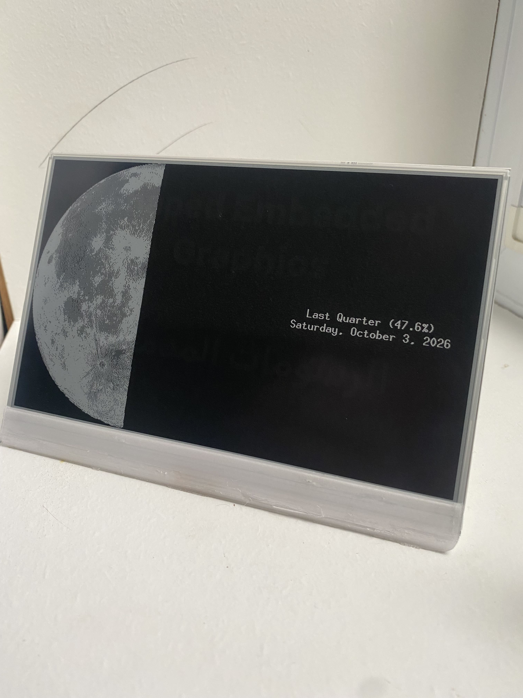

# Paperbox - a Set of Demos for a TRMNL OG DIY Kit

This is a sandbox repo for my TRMNL OG DIY kit, with demos that can:

- Display Astronomical Info
- Render Fully Shaped .ttf fonts
- Play Bad Apple
- Display the Mandlebrot set
- Display zlib compressed images
- Split other demos

## Structure

- boardbase-hal: controls the ESP32-S3
- uc8179: controls the E-Paper Display
- demos: provides a variety of demos
